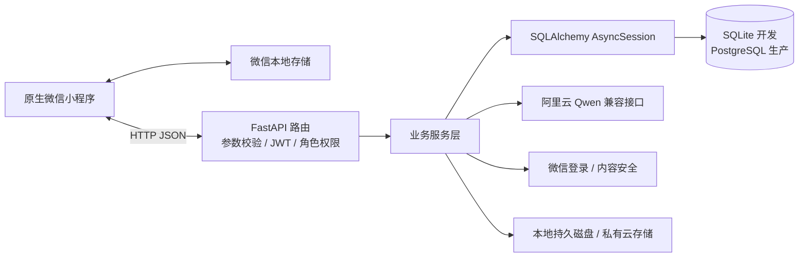

# 系统架构

更新日期：2026-10-12。本文说明当前源码结构；运行步骤和交接边界见 [技术交接说明](technical-handoff.md)。

## 总览

当前为**前后端分离的模块化单体**，不绑定某个托管平台。

## 模块职责

| 位置 | 职责 |
| --- | --- |
| `miniprogram/pages/`、`components/` | 用户端、管理员、AI 悬浮入口、通知及图标 |
| `miniprogram/utils/transport.js` | 直连及保留的 `callContainer` 传输适配 |
| `server/app/api/v1/` | REST 接口、参数与依赖声明 |
| `server/app/services/` | AI、配额、媒体、用户、膳食和互动相关业务 |
| `server/app/models/`、`db/` | 关系模型、异步会话、原始五表目录及版本修复 |
| `server/alembic/` | 数据库迁移，目前到 `0006_original_survey_catalog` |

## 数据流

- **登录：** 微信 code → 服务端换取 openid → 用户记录 → JWT；管理员采用账号密码登录，后端按数据库角色检查权限。
- **评估：** 模板读取 → 动态填写/跳题 → 答案及题目快照保存 → 可选 AI 解读。原始五表无评分规则，保存 `null` 分数。
- **AI：** 鉴权 → 数据库配额预留 → 服务端 Qwen 网关 → 校验结果并返回。对话上下文由客户端传入，不存在云端 AI 聊天历史表。
- **互动：** 数据库文章 → 点赞/收藏/评论 → 站内通知 → 客户端查询与轮询。
- **图片：** 校验/重编码 → 私有媒体适配 → 不透明引用与短期签名代理。食品识别照片经处理后发给模型，营养结果属于估算。

打卡、问卷草稿、AI 对话历史及界面位置保存在微信本地存储。用户资料、评估提交、膳食、文章互动和通知存后端。科普文章尚未接入向量检索或 RAG。

## 部署与开放状态

自建 Windows 和根 Dockerfile 提供后端运行资产；当前小程序正式构建脚本生成 HTTPS 直连配置。CloudBase 适配保留，但源码没有预绑定环境。GitHub 最新代码与历史服务器部署是不同状态。

医生预约/聊天及相关管理路由受 `ENABLE_CLINICAL_SERVICES=false` 默认开关控制。医生和 GIS 页面未注册到当前用户版；不能将保留代码视为已开放服务。

架构选择、实际技术版本、运行配置与后续事项统一见 [技术交接说明](technical-handoff.md)。
