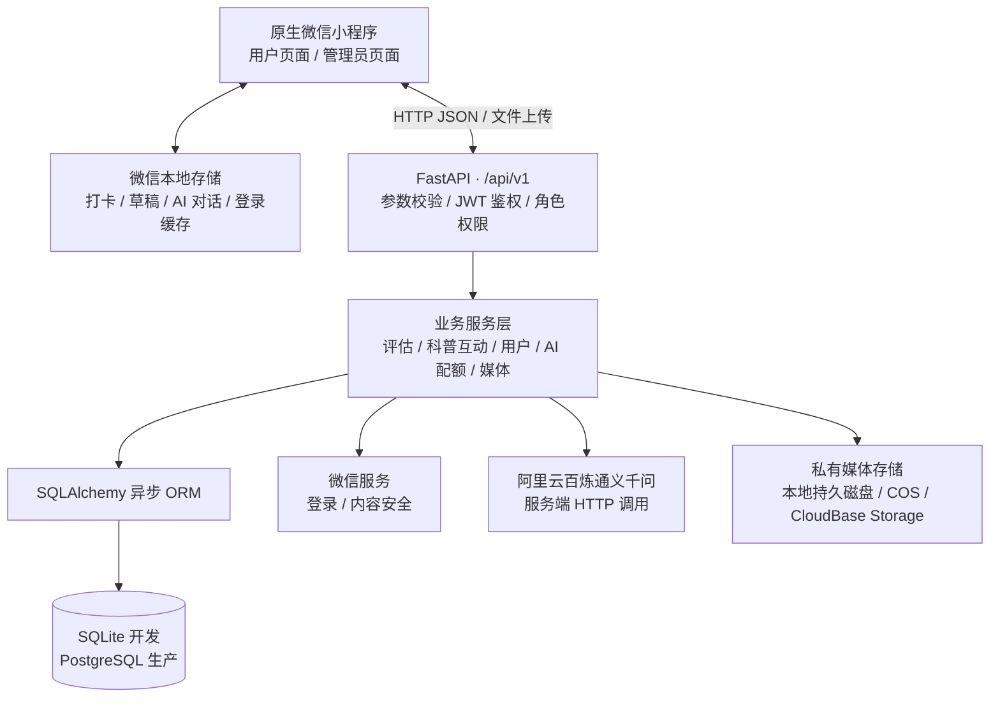

# 膳知有伴｜项目技术简介与交接说明

更新日期：2026-10-12。本文依据当前代码核对，适用于技术团队接手开发，不代表最新代码已部署或通过上线验收。

## 1. 项目概述与交接版本

膳知有伴是一套面向营养与食品安全科普、体重管理信息采集和健康习惯培养的微信小程序。当前用户端包括健康评估、打卡指导、AI 科普、科普互动和个人中心，另有独立管理员入口。产品采用服务蓝色系、较大字号和触控区域、明确的选中状态与操作反馈，兼顾中老年用户阅读和使用。

项目采用**原生微信小程序 + Python FastAPI 异步后端 + 关系型数据库 + 服务端通义千问网关**。整体是前后端分离的模块化单体架构；没有使用 React、Vue、uni-app 或微服务集群，也不依赖 Railway 才能运行。

| 交接项 | 当前状态 |
| --- | --- |
| GitHub 仓库 | [oceanduck403/cdc-for-food](https://github.com/oceanduck403/cdc-for-food) |
| 最新交接分支 | `fix/survey-registration-loading`；请明确切换此分支，不能假定默认分支 `main` 包含最新修复 |
| 本轮业务代码基线 | `d636eb7`；本文及相关说明在其后的文档提交中补齐 |
| 当前验证方式 | 电脑微信开发者工具 + 独立本地 SQLite + 真实千问文字问答 |
| 发布状态 | 本次只交接代码和文档，不上传小程序、不提交审核、不部署服务器 |

```powershell
git clone --branch fix/survey-registration-loading git@github.com:oceanduck403/cdc-for-food.git
cd cdc-for-food
git log -1 --oneline
```

私有仓库访问权限、平台账号和运行数据需要项目方另行交接。

## 2. 底层架构



后端按路由、业务服务、数据模型和数据库会话分层。小程序统一通过网络传输层访问 API，AI 密钥由后端持有。知识文章存储与 AI 调用目前是两条独立链路；文章库尚未自动进入模型检索上下文。

主要决策及取舍：

| 选择 | 依据 | 可替换方向 | 维护边界 |
| --- | --- | --- | --- |
| 原生微信小程序 | 直接使用微信组件与平台 API | 多端框架 | 扩展到独立 App 时需要适配前端 |
| FastAPI 模块化单体 | 接口、AI 与数据处理共用 Python，便于开发交接 | 按业务拆分服务 | 当前没有分布式任务系统或集群编排 |
| 关系库保存业务及配额 | 减少额外依赖，支持事务和唯一约束 | 独立缓存/队列 | 高并发能力需专门压测 |
| 服务端 AI 网关 | 集中保管密钥、控制请求与用量 | 更换兼容接口供应方 | 第三方成本、可用性和结果质量需要运营管理 |

## 3. 技术栈

| 层次 | 技术 | 用途 |
| --- | --- | --- |
| 小程序前端 | JavaScript/CommonJS、WXML、WXSS、微信 `Page`/`Component` | 页面、组件、状态和原生能力；无前端 npm 运行依赖 |
| 小程序基础库 | 项目配置 `3.17.0`，`style: v2`、按需加载组件 | 当前开发工具配置基线 |
| Python | 当前本机实测 `3.12.14`；仓库根 Dockerfile 使用 Python 3.12 | 后端及本地启动器 |
| Web 服务 | FastAPI `0.115.4`、Uvicorn `0.32.0` | REST API 与 ASGI 服务 |
| 参数/配置 | Pydantic `2.9.2`、pydantic-settings `2.6.1` | 请求结构校验、环境变量读取 |
| 数据访问 | SQLAlchemy `2.0.36`、asyncpg `0.30.0`、aiosqlite `0.20.0` | 异步 ORM、PostgreSQL/SQLite 驱动 |
| 数据库迁移 | Alembic `1.13.3` | 表结构版本管理，目前到 `0006_original_survey_catalog` |
| 鉴权 | PyJWT `2.10.1`、bcrypt `4.2.1` | JWT 会话、管理员密码哈希 |
| 外部请求 | HTTPX `0.27.2` | 微信接口及 Qwen 网关 |
| 图片/媒体 | Pillow `11.0.0`、可选腾讯云 COS SDK | 图片校验、去元数据、压缩、重编码和私有存储 |
| 日志 | Loguru `0.7.2` | 服务日志及轮转 |
| 构建/前端测试 | Node.js；本机实测 `v24.19.0` | 发布包脚本、原生 `node:test` 测试；不是后端运行时 |
| 后端测试 | pytest `8.3.3`、pytest-asyncio `0.24.0` | API、权限、迁移、AI 网关回归 |

依赖准确版本以 [requirements.txt](../server/requirements.txt) 为准。`requirements-selfhost.txt` 未包含独立 COS SDK，选择 COS 存储时需使用完整依赖。界面图标实际来源为 **Ant Design Icons SVG 4.6.0，MIT 许可**，保留 SVG 并本地导出 PNG；阿里巴巴矢量图标库是风格参考，并非在线图标服务。见 [图标来源说明](../miniprogram/images/ui/SOURCES.md)。

## 4. 当前功能与实现方式

| 模块 | 已实现内容 | 数据和边界 |
| --- | --- | --- |
| 健康评估 | 原始五表、动态渲染、分页、条件跳题、日期/时间/小数、草稿、提交及历史 | 提交存后端；草稿存本机；未评分与 0 分明确区分 |
| 打卡指导 | 膳食/运动/饮水打卡、每日三项进度、七日足迹、累计/连续天数及鼓励反馈 | 打卡保存在当前设备，尚无服务端同步；AI 每日建议由后端生成 |
| AI 科普 | 文字问答、快捷问题、上下文、失败重试、拍照/相册食物分析入口 | 对话历史存本机；本轮真实验证了文字问答，不等于已完成所有图片模型验证 |
| AI 悬浮入口 | 吉祥物样式、拖动吸边、位置记忆、底部避让、点击导航 | 进入 AI 科普底栏页；不是语音 Siri，也没有语音识别链路 |
| 科普互动 | 文章分类/搜索/分页、详情、点赞、收藏、评论/回复、评论点赞、举报 | 数据存后端；普通用户没有科普素材发布入口 |
| 消息与收藏 | 互动通知、未读数、筛选、已读、跳回文章和收藏列表 | 入口在科普页；消息采用 HTTP 查询，入口每 30 秒轮询未读数，并非系统推送 |
| 我的/资料 | 微信登录、头像拍照/相册修改、昵称及健康资料、隐私条款、退出/注销 | 资料及头像存后端；本机缓存辅助展示 |
| 管理员 | 独立登录、概览、用户查询、问卷模板元数据/启停/新增、提交记录、修改账号密码 | 还没有完整的可视化题目编辑器或科普文章 CMS 发布流程 |

当前注册 19 个小程序页面、5 个底栏入口。适老化已包含较大文字/按钮、深色正文、清晰选中态和操作反馈，但没有独立字号切换、长辈模式或语音模式。

### 原始表单

| 类型标识 | 名称 | 数字化字段/题数 |
| --- | --- | --- |
| `weight_visit_registration` | 体重管理门诊就诊信息登记表 | 10 |
| `weight_basic_info` | 体重管理门诊病历首页 | 21 |
| `weight_clinic_first` | 体重管理门诊首诊评估表 | 50 |
| `weight_anti_obesity` | 体重管理门诊防肥分数自测表 | 36，11 个分组 |
| `weight_clinic_follow` | 体重管理门诊复诊评估表 | 26 |

题目目录位于 `server/app/db/survey_catalog.json`，记录两份原始 Word 的文件名与 SHA256。题目、选项、顺序和跳题条件依据原稿恢复；原稿没有计分公式，因此原始五表提交强制 `total_score=null`，不编造分数、权重或风险等级。登记表只保存登记信息，其余表可请求 AI 科普解读。

迁移先为既有提交保存题目快照，修复模板时按 `catalog_revision` 执行一次，保留后续管理员修改；新提交也保存 `questions_snapshot`，避免模板变化改写历史题义。详见 [原始表单说明](survey-registration.md)。

## 5. 数据流与关键实现

**登录：** `wx.login` 获取 code → `/auth/wechat` → 微信 `jscode2session` → 建立/读取用户 → 签发 JWT。管理员使用独立账号密码接口；后端检查数据库中的角色、启用状态和会话有效性。

**评估：** 小程序读取启用模板 → 按原题与条件渲染 → 提交答案并冻结题目 → 可选调用 `/ai/survey-analysis`。AI 分析前将题号映射成原始题干、分组、单位及提示，未知题号和未答题不作猜测；AI 失败保留填写与提交状态，可重试。

当前新生成的问卷 AI 解读只更新页面状态，尚未回写提交记录的 `analysis` 字段；历史记录可恢复题目和答案，但不能假定会自动恢复这次新生成的 AI 解读。

**AI：** 登录验证 → 主数据库预留配额 → 服务端场景提示词/必要上下文 → 阿里云兼容 OpenAI 的 `/chat/completions` → 检查返回值 → 向小程序返回结果。是普通异步 HTTP 请求后返回完整答复，尚无 SSE 流式输出或 WebSocket AI 通道。客户端 AI 请求超时 45 秒，服务端上游 HTTPX 超时 30 秒。

模型由 `QWEN_MODEL` 配置：源码/示例默认是 `qwen-vl-plus`；**本次独立本地演示启动器固定使用 `qwen3.8-27b` 和北京兼容接口**。文字问答最多发送最近 12 条历史，每条最多 2000 字符；本机保存最多 30 条。食品标签问题追加固定的已核对资料及官方链接，不是完整 RAG；当前没有向量数据库、Embedding、模型训练或微调。

食物分析接口对照片校验、去元数据、缩放重编码，再请求模型返回食品/营养估算 JSON，保存为膳食记录；部分后续说明来自本地规则。接手方须单独核对选配模型的图片能力、调用权限和输出质量，不能把估算当作食品检测或诊疗结果。

**互动：** 文章点赞/收藏由关系表与唯一约束防重复；评论使用 `request_id` 支持幂等重试；互动生成站内通知。科普素材后续由项目方/疾控方提供，当前没有完成自动素材对接及后台发布流程，开发种子文章不能当成已审核的正式素材库。

## 6. 存储、安全与配置

| 位置 | 存储内容 | 接手注意 |
| --- | --- | --- |
| 关系数据库 | 用户、模板/提交、文章/互动/通知、AI 配额、膳食及预留临床记录 | Git 不包含运行数据库；问卷题目/答案为 Text 内 JSON |
| 微信本地存储 | token、资料缓存、问卷草稿、打卡、AI 对话、悬浮入口位置 | 不是跨设备云同步，也不能宣称所有本地信息已加密 |
| 媒体存储 | 头像，及开启临床后使用的图片消息 | 支持 `local` / `local_persistent` / `cos` / `cloudbase_pg`；通过短期签名代理访问 |
| 服务端环境配置 | 微信/AI/数据库/JWT/媒体等配置 | 真实值不进入源码、小程序包或交接文档 |

管理员密码使用 bcrypt；修改管理员账号或密码后旧 JWT 失效；停用或注销的账号也不能继续凭旧 token 访问。生产模式启用微信内容安全审核，开发/测试模式跳过真实审核；本机成功不代表生产审核链路已验证。

主要配置项如下，完整模板见 [server/.env.example](../server/.env.example)：

| 配置组 | 变量 |
| --- | --- |
| 运行环境 | `APP_ENV`、`APP_LOG_DIR`、`DATABASE_URL` |
| 会话 | `JWT_SECRET`、`JWT_ALGORITHM`、`JWT_EXPIRE_MINUTES` |
| 微信身份 | `WECHAT_APPID`、`WECHAT_SECRET` |
| AI | `QWEN_API_KEY`、`QWEN_BASE_URL`、`QWEN_MODEL` |
| AI 配额 | `DAILY_ANALYSIS_LIMIT_PER_USER`、`IMAGE_MAX_BYTES` |
| 首个管理员 | `ADMIN_BOOTSTRAP_USERNAME`、`ADMIN_BOOTSTRAP_PASSWORD` |
| 医生相关服务 | `ENABLE_CLINICAL_SERVICES`，默认 `false` |
| 媒体 | `MEDIA_STORAGE_BACKEND`、`MEDIA_STORAGE_DIR`，以及选用云存储的对应变量 |

后端配额默认每日 20 次、每分钟最多 6 次，按北京时间跨日，失败调用释放预留。**前端 AI 页另有每日 10 次本机限制**，拍照页面配置为 20；接手后应统一展示与服务端规则。配额存在主数据库，没有独立 Redis。

生产配置校验要求 PostgreSQL、足够长的 JWT 密钥、微信/AI 凭证、绝对日志目录和持久化媒体配置。已有权限校验、图片处理、内容安全、配额和日志，并不等于完成了安全审计、数据加密方案或正式合规验收。

## 7. 接手后的电脑本地运行

以下操作针对 Windows、新建测试环境，不连接或迁移现有生产库。

### 后端

在仓库根目录执行：

```powershell
py -3.12 -m venv server/.venv
server/.venv/Scripts/python.exe -m pip install -r server/requirements.txt
if (-not (Test-Path -LiteralPath 'server/.env')) {
    Copy-Item server/.env.example server/.env
}
```

上述复制命令只用于首次创建配置，不覆盖已有 `.env`。在本机 `server/.env` 安全填写微信与千问凭据后执行：

```powershell
server/.venv/Scripts/python.exe deploy/selfhost/run_local_demo.py
```

启动器在 `%LOCALAPPDATA%/CDC-Food/local-demo` 建立独立 SQLite、JWT、日志和媒体目录，先迁移，再仅首次插入原始五表及开发参考内容；API 为 `http://127.0.0.1:18121/api/v1`，健康检查为 `http://127.0.0.1:18121/health`，接口文档为 `http://127.0.0.1:18121/docs`。可用 `--runtime` 指定独立目录。已有端口不属于本实例时拒绝继续，不停止其他进程。

启动器显式从 `.env` 提取千问 Key 和微信凭据，并强制覆盖数据库、JWT 密钥、监听地址、开发模式、模型及存储等演示参数；其他未覆盖选项仍遵循后端配置。演示默认关闭临床服务，不创建默认管理员。若要配置其他模型、管理员或测试 PostgreSQL，需在独立环境按标准后端流程配置，而不是把生产环境配置套入演示启动器。开发初始化脚本重复运行会重复插入参考文章，启动器使用标记避免重复 seed。

### 小程序

1. 微信开发者工具导入**仓库根目录**，由 `project.config.json` 指向 `miniprogram/`。
2. 真实微信登录需配置对应 AppID、AppSecret 和开发者权限；测试号不能替代真实身份链路。
3. 仅电脑开发联调时，在工具「详情 → 本地设置」按需勾选「不校验合法域名、web-view（业务域名）、TLS 版本以及 HTTPS 证书」。此设置不适用于体验版/正式版。在小程序调试控制台执行：

```javascript
wx.setStorageSync('__cdc_api_transport__', 'direct')
wx.setStorageSync('__cdc_api_base__', 'http://127.0.0.1:18121/api/v1')
```

4. 重新编译并登录。切换数据库/JWT 后应退出旧会话再登录，避免清空全部缓存而丢失本机打卡和草稿。

源码的 `release-runtime.js` 故意为 `unconfigured`；上述覆盖只对 `envVersion=develop` 有效。当前电脑已有的 `build/local-demo-20261012` 是本机生成产物，不在 Git 中；其他电脑按以上步骤从源码重现。手机不能使用电脑的 `127.0.0.1`，真机联调需单独准备可访问的服务地址。

## 8. 部署适配与当前边界

代码保留自建 Windows 服务器、容器和 CloudBase 传输适配。微信开发者工具上传的是小程序前端，Python 后端需要独立运行环境；不必使用 Railway。

- **Windows 自建：** `deploy/windows/` 提供迁移、启动、计划任务、备份和证书相关脚本，历史方案使用项目独立目录和端口，避免影响同机其他服务。实际主机参数、任务状态和数据需单独交接，本文未重新核验服务器。
- **容器：** 优先以仓库根 Dockerfile 为基线，Python 3.12，启动时执行 Alembic 与初始化，再运行 Uvicorn。生产数据库使用 PostgreSQL，媒体必须持久化或使用私有云存储。
- **小程序正式构建：** `deploy/selfhost/build_miniprogram.js` 将 HTTPS API 写入独立 `build/wechat-release/` 并提供静态校验；当前脚本生成 `direct` 直连配置，不自动上传/提审。体验版与正式版忽略开发者工具存储覆盖。
- **CloudBase：** 网络层仍支持 `callContainer`，但源码没有现成环境/服务绑定，当前正式构建脚本也不生成云传输包；需要接手方另行配置和验证。
- **历史文件：** `server/Dockerfile` 的 Python 3.11 构建未复制 Alembic；旧 `server/docker-compose.yml` 含示例数据库口令和端口暴露，不能直接作为生产方案。部分旧云文档描述的是历史计划，应以本文及当前配置代码为准。

本次交接不执行以上部署动作。最新 GitHub 版本不等于历史服务器、体验版或正式版已更新。

## 9. 未开放与后续优先事项

1. **素材运营：** 确定疾控素材交付格式、审核/发布/撤回流程，补齐受控导入或 CMS；目前患者不能发布科普素材。
2. **表单管理：** 后端支持题目数据，但前端管理员界面缺少完整题目编辑器；新增空模板需补齐有效题目才能使用。修改原表计分方式前需取得明确规则。
3. **数据同步：** 为打卡和 AI 历史设计服务端同步、迁移和备份流程；补齐新生成问卷 AI 解读回写提交记录的流程。现阶段换设备不会自动恢复本机记录，评估历史也不能自动恢复未保存的新 AI 解读。
4. **AI 运营：** 统一前后端次数展示；核对文本/图片模型权限及质量，建立专业复核与回归集。当前仅有场景提示词和部分固定依据，没有完整检索增强系统。
5. **未开放模块：** 医生预约、分配、聊天及医生页面源码保留，后端默认不挂载临床路由，前端未注册医生页面且正式打包排除。GIS 有后端与历史代码，当前用户版没有地图入口。微信运动、会员支付、打卡赠 AI 次数均未接通。
6. **继续验证：** 真机相机/头像流程、不同机型与字号、生产内容审核、数据库恢复、并发与成本边界，应由接手方按验收场景验证。

## 10. 目录导航、测试与交接材料

| 路径 | 作用 |
| --- | --- |
| `miniprogram/app.json`、`app.wxss` | 页面注册、底栏与全局视觉样式 |
| `miniprogram/pages/`、`components/`、`utils/` | 页面、悬浮入口/图标/通知组件、请求与业务工具 |
| `server/app/main.py`、`config.py` | 应用入口与环境配置 |
| `server/app/api/v1/`、`services/`、`models/` | API、业务与模型 |
| `server/app/db/survey_catalog.json` | 原始五表目录与来源指纹 |
| `server/alembic/` | 数据库迁移链 |
| `deploy/selfhost/`、`deploy/windows/`、根 `Dockerfile` | 本地启动、小程序构建、自建及容器资产 |
| `miniprogram/tests/`、`server/tests/` | 前后端回归测试 |
| `sync/` | 历史 RSS 工具；当前外部知识库关闭，无运行中的 GitHub Actions 同步链路 |
| 根 `app/`、`build/` | 前者不是活动应用；后者为忽略的本机构建产物 |

测试命令：

```powershell
# 仓库根目录
node --test miniprogram/tests/*.test.js

# server 目录
.venv/Scripts/python.exe -m pytest -q
```

业务基线在 2026-10-12 的验证结果：前端 **68 项通过**，后端 **124 项通过**；另在开发者工具验证五表、跳题、时间/小数和真实 AI 文字问答。后端测试存在依赖/日期 API 的弃用警告；测试通过不代表完成全部真机、安全或上线验收。本文档更新不修改业务逻辑。

除 GitHub 源码外，项目方还需通过安全渠道交接：

- GitHub 仓库权限、微信小程序管理与开发成员权限。
- 微信 AppSecret、千问 Key 所属账号/地域/模型/计费、JWT 及数据库/存储凭据；这些真实值不写入 Git。接手后按负责人确认的方案轮换凭据。
- 现有数据库备份、媒体目录/存储桶、部署环境配置、服务器运维资料、域名/DNS/证书及续期任务资料；不要把健康数据夹入演示数据。
- 两份原始 Word 表单，单独传给接手者并与题库的 SHA256 核对；还需交接最终 UI 素材及待接入的正式科普材料。

`.env`、数据库、用户媒体、私钥、原始 Word 和本机构建结果被 Git 忽略。**只有代码仓库不足以恢复完整运行环境，必须同时完成运行资源与资料交接。**
